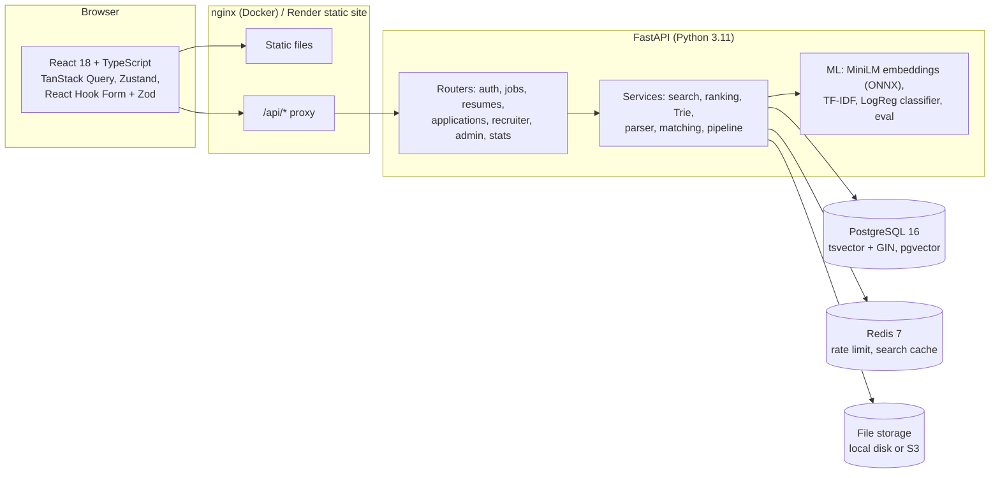

# Hike

A job portal and recruitment platform. Job seekers search and filter jobs, upload a resume that is parsed into skills and experience, and see a match score for every job with the reasons behind it. Recruiters post jobs, see candidates ranked by match score, and move them through a hiring pipeline on a drag-and-drop board. Admins manage users and jobs.

Built with FastAPI, PostgreSQL (full-text search + pgvector), Redis, sentence-transformers / ONNX Runtime, scikit-learn, React 18 and TypeScript.


- **Live demo:** _add the Render URL after deploying (see [Deployment](#deployment))_
- **API docs:** `/api/docs` (FastAPI Swagger UI) on any running instance, e.g. http://localhost:8080/api/docs
- **Author:** Sai Pavan ([@Saipavanavsp](https://github.com/Saipavanavsp))

## Contents

- [Features](#features)
- [Screenshots](#screenshots)
- [Architecture](#architecture)
- [Matching algorithm](#matching-algorithm)
- [Search ranking](#search-ranking)
- [Evaluation](#evaluation)
- [Run locally](#run-locally)
- [Demo accounts](#demo-accounts)
- [Tests](#tests)
- [Deployment](#deployment)
- [Project layout](#project-layout)

## Features

**Job seekers**
- Search with PostgreSQL full-text search (title, company, skills, description), title/skill autocomplete from an in-memory Trie, filters (location, role, experience, remote) and sorting (relevance, newest, salary, match %). 20 results per page; filters live in the URL.
- Resume upload (PDF or DOCX, max 5 MB) with extension, MIME and magic-byte checks. Text extraction with pdfplumber / python-docx; skills, years of experience, education, email and phone are parsed. The seeker reviews and edits the parsed skills before saving.
- Match score (0-100) on every job, with a text breakdown: skills matched (e.g. 7/9) plus the missing skills, experience fit and location fit.
- Apply with an optional note; track status and a timeline of every change; save jobs; in-app notifications.

**Recruiters**
- Post, edit, close and reopen jobs (markdown descriptions).
- Kanban pipeline per job: Applied / Shortlisted / Interview / Offer / Rejected, built with dnd-kit. Usable with keyboard (Space to pick up, arrows to move) and through each card's menu. Invalid moves (e.g. Applied to Offer) are blocked on the client and the server.
- Ranked list of candidates by match score with a skill-gap column; resume download; "Applications this week" line chart.

**Admins**
- Users, jobs and applications tables with search, column sorting, pagination, checkbox bulk actions (deactivate/activate users, close jobs) and a confirmation dialog.

**Platform**
- JWT access tokens (15 min, in memory only) and rotating refresh tokens (7 days, httpOnly cookie, stored hashed; reuse of a rotated token revokes the whole token family).
- Role guards return 401 for unknown callers and 403 for authenticated users without permission.
- Login rate limit in Redis: 5 failed attempts per email + IP per 15 minutes.
- Search results cached in Redis for 60 s; one version counter invalidates every cached search when any job changes.

## Screenshots

| | |
|---|---|
|  |  |
| Job detail with the match breakdown | Recruiter pipeline (kanban) and weekly chart |
|  |  |
| Candidates ranked by match score with skill gaps | Admin users table with bulk actions |
|  |  |
| Parsed resume and predicted role category | Mobile: bottom tab bar and two-line rows |

All screenshots are of the running app with the seed data, captured by Playwright (`e2e/tests/screenshots.spec.ts`).

## Architecture



The SPA calls the API on the same origin (`/api/...`): the Vite dev server, nginx in Docker and a Render rewrite rule all proxy it. That keeps the refresh-token cookie first-party (`SameSite=Lax`, `HttpOnly`, `Secure` in production) without third-party cookie problems.

**Database schema (main tables):** `users`, `refresh_tokens`, `seeker_profiles`, `recruiter_profiles`, `companies`, `jobs` (with `search_vector tsvector` maintained by a trigger and `embedding vector(384)`), `saved_jobs`, `resumes` (parsed JSON, confirmed skills, embedding, predicted category; partial unique index for one current resume per seeker), `match_scores` (cached breakdowns keyed by resume and job signatures), `applications` (unique on job + seeker), `application_status_history`, `notifications`, `eval_runs`. Migrations are in `backend/alembic/versions`.

## Matching algorithm

`backend/app/services/matching.py`

```
score = 100 × (0.50 × semantic + 0.35 × skill_overlap + 0.10 × experience_fit + 0.05 × location_fit)
```

| Component | How it is computed |
|---|---|
| semantic | Cosine similarity between `all-MiniLM-L6-v2` embeddings of the resume text and the job (title + skills + description). Long documents are split into ~180-word windows (the model truncates at 256 word pieces), and the window vectors are averaged and re-normalised. The raw cosine is rescaled linearly from [0.15, 0.65] to [0, 1]: whole-document MiniLM cosines sit in a narrow band (on the eval set, relevant pairs have a median of 0.46 and non-relevant pairs 0.34), so without rescaling a perfect candidate could not score above ~35/50 on this component. |
| skill_overlap | Required job skills found in the resume's confirmed skills ÷ required skills. Both sides go through the skills taxonomy, so "Postgres" matches "PostgreSQL". |
| experience_fit | 1 inside [min, max]; −0.5 per year below the minimum; −0.1 per year above the maximum, floored at 0.6 (overqualified is a soft mismatch); 0.5 if unknown. |
| location_fit | 1 if the job is remote and the seeker is open to remote, or the job city is one of the seeker's cities (current or preferred), or the seeker set none; otherwise 0. |

The API returns `{score, skills_matched, skills_missing, skills_ratio: "7/9", experience_ok, location_ok, ...}`, and the UI shows it as text, not a gauge.

**Embeddings in production.** `sentence-transformers` needs PyTorch (~500 MB RAM), which does not fit a 512 MB free instance. Production uses the official ONNX export of the same model with `onnxruntime` + `tokenizers` and identical mean pooling. `tests/test_embeddings.py` asserts that the ONNX vectors match the sentence-transformers reference to within 1e-4 (measured max difference: 1.1e-7). Set `EMBEDDING_BACKEND=sentence-transformers` to use the reference library.

**Caching.** Job and resume embeddings are stored in Postgres (`vector(384)`) with a content hash, and recomputed only when the text changes. Match breakdowns are cached in `match_scores`, keyed by a signature of the resume (embedding hash, skills, years, location preferences) and of the job (embedding hash, skills, experience, location). Editing a profile or job invalidates only the affected rows. The model is loaded once at startup.

**Skills extraction.** `backend/app/ml/data/skills_taxonomy.json` has 309 skills with aliases ("JS" → JavaScript, "k8s" → Kubernetes, "sklearn" → scikit-learn). Text and aliases go through the same tokenizer, and matching is greedy longest-n-gram (up to 4 tokens), so "React Native" wins over "React". Words that are also common English ("Go", "Swift", "Spring", "R") only match their exact capitalised form.

**Role classifier.** TF-IDF (word 1-2 grams) + logistic regression predicts Backend / Frontend / Full-Stack / Data-ML / DevOps / Mobile / QA from resume text. The prediction is shown to the seeker and recruiter, is filterable in the recruiter API, and is a small signal in search ranking.

## Search ranking

`backend/app/services/ranking.py` and `search.py`

PostgreSQL does the filtering and full-text match (`websearch_to_tsquery` against a weighted `tsvector`: title A, company and skills B, description C; GIN index). It returns up to 1,000 candidates with their `ts_rank_cd`, and these are cached in Redis. The "relevance" order is then computed in Python:

```
score = 0.45 × text_relevance + 0.35 × match + 0.15 × recency + 0.05 × category_fit
```

- `text_relevance` = `ts_rank_cd / (ts_rank_cd + 1)`, squashing the unbounded rank into [0, 1).
- `match` = match score / 100 for the signed-in seeker.
- `recency` = `exp(−ln 2 × age_days / 14)`: 1.0 today, 0.5 at two weeks, 0.25 at four.
- `category_fit` = 1 if the job's role category equals the category predicted for the seeker's resume.

When a signal is unavailable (no search text, no resume), its weight is dropped and the remaining weights are renormalised.

**Complexity.** For n filtered candidates and page p of size s, scoring is O(n), and the best k = p·s are selected with a heap (`heapq.nlargest`) in O(n log k) instead of sorting everything in O(n log n). Match scores for the candidates come from the `match_scores` cache; only stale pairs are recomputed, as one batched dot product per job.

**Autocomplete Trie** (`services/trie.py`). Each job title and skill is inserted under every word start, so "back" finds "Senior Backend Engineer". Terminal nodes store how many open jobs use the term. A query walks the prefix in O(P), collects the M terms below it, and picks the top k by frequency in O(M log k). Each API worker keeps its own Trie and rebuilds it lazily when the shared jobs version counter in Redis changes.

## Evaluation

Run it yourself (it also runs during seeding, and the latest result is stored in `eval_runs`, which feeds the landing-page stats):

```powershell
cd backend
.\.venv\Scripts\python -m app.ml.eval          # or: docker compose exec backend python -m app.ml.eval
```

**Data.** 20 seed resumes, parsed from their PDFs with the real parser, against 50 seed jobs. That gives 1,000 pairs, 119 of them labelled relevant. The labels come from a rule written in `seed/build_seed_data.py` and saved in `seed/data/eval_pairs.json`: a job is relevant if it is in the candidate's role family and the candidate's experience is at most 1 year under the job's minimum or 2 years over its maximum. All jobs and resumes are synthetic and written for this project.

**Matching** (numbers produced by `python -m app.ml.eval`, identical on Windows and in the Linux container):

| Method | Precision@5 | Recall@5 | MRR | Accuracy* |
|---|---|---|---|---|
| TF-IDF cosine (baseline) | **0.760** | **0.669** | 1.000 | **0.933** |
| MiniLM embeddings cosine only | 0.690 | 0.593 | 0.975 | 0.919 |
| Hike match score (full formula) | 0.740 | 0.651 | 1.000 | 0.929 |

\* Accuracy of the decision "the top-5 jobs per resume are relevant, the rest are not" over all 1,000 pairs.

What this shows, honestly:
- On this dataset the TF-IDF baseline beats the embedding model. The seed job descriptions are keyword-dense and share boilerplate within each role family, which favours exact term overlap. On free-form text (different words for the same skill) the semantic signal should matter more, but this dataset does not prove that.
- The full Hike score improves on embeddings alone (P@5 0.69 → 0.74) because of the skill-overlap and experience signals. The experience rule is part of how the labels were defined, which flatters the full score somewhat.
- 20 resumes is a small sample. Treat these numbers as a reproducible sanity check, not a benchmark.

**Role classifier**

| Evaluation | Samples | Accuracy |
|---|---|---|
| 5-fold stratified CV on the training set | 280 | 1.000 (macro F1 1.000) |
| Held-out: the 20 seed resumes | 20 | 1.000 |

Confusion matrix on the 20 seed resumes (rows = true, columns = predicted: backend, frontend, fullstack, data_ml, devops, mobile, qa):

```
backend    [4, 0, 0, 0, 0, 0, 0]
frontend   [0, 3, 0, 0, 0, 0, 0]
fullstack  [0, 0, 3, 0, 0, 0, 0]
data_ml    [0, 0, 0, 4, 0, 0, 0]
devops     [0, 0, 0, 0, 2, 0, 0]
mobile     [0, 0, 0, 0, 0, 2, 0]
qa         [0, 0, 0, 0, 0, 0, 2]
```

Perfect scores here mean the task is easy on synthetic data. The training texts are generated from templates (`seed/build_classifier_data.py`), and the seed resumes use clear role vocabulary. Expect lower accuracy on real resumes, especially Full-Stack versus Frontend/Backend.

## Run locally

**Requirements:** Docker Desktop. That is all you need for the full app.

```powershell
git clone https://github.com/Saipavanavsp/hike.git
cd hike
docker compose up --build
```

The first build takes a few minutes (it downloads the ONNX model). On first start the backend runs migrations, seeds the demo data and runs the evaluation (about 30 s), then serves:

- App: http://localhost:8080
- API docs: http://localhost:8080/api/docs
- API directly: http://localhost:8000

To start over with fresh data: `docker compose down -v`, then `docker compose up --build`.

**Developing without Docker for the app code** (Postgres and Redis still run in Docker). Needs Python 3.11+ and Node 20+.

```powershell
docker compose up -d postgres redis

# backend
cd backend
python -m venv .venv
.\.venv\Scripts\python -m pip install -r requirements-dev.txt
Copy-Item .env.example .env
.\.venv\Scripts\alembic upgrade head
.\.venv\Scripts\python -m seed.seed --reset
.\.venv\Scripts\uvicorn app.main:app --reload --port 8000

# frontend (second terminal)
cd frontend
npm install
npm run dev          # http://localhost:5173, proxies /api to :8000
```

## Demo accounts

| Role | Email | Password |
|---|---|---|
| Admin | admin@example.com | Admin@123 |
| Recruiter | meera@example.com | Recruiter@123 |
| Recruiter | rohan@example.com | Recruiter@123 |
| Recruiter | ananya@example.com | Recruiter@123 |
| Seeker (Backend) | rahul@example.com | Seeker@123 |
| Seeker (Frontend) | aditya@example.com | Seeker@123 |
| Seeker (Full-Stack) | pooja@example.com | Seeker@123 |
| Seeker (Data/ML) | vikram@example.com | Seeker@123 |
| Seeker (Mobile) | aman@example.com | Seeker@123 |

The other 15 seeded seekers use `<firstname>@example.com` with the same password. All companies, people and resumes are fictional.

## Tests

| Suite | Command | What it covers |
|---|---|---|
| Backend (PyTest) | `cd backend; .\.venv\Scripts\python -m pytest --cov=app` | 137 tests: auth (rotation, reuse detection, rate limit, 401 vs 403), search/filters/sort/pagination/cache invalidation, Trie, ranking, resume parsing on 3 fixture resumes (2 PDF, 1 DOCX), skills taxonomy, embeddings (ONNX vs reference), matching and its cache, classifier, eval harness, applications pipeline and permissions, admin, seed. Needs Postgres and Redis (`docker compose up -d postgres redis`). |
| Frontend (Vitest + RTL) | `cd frontend; npm test` | 26 tests: MatchPill thresholds, filter chips, login/register validation, kanban moves and allowed transitions, formatting. |
| E2E (Playwright) | `cd e2e; npm ci; npx playwright install chromium; npx playwright test` | Against the running stack on :8080: a seeker logs in, searches, opens a job, checks the match breakdown and applies; the recruiter moves them to Shortlisted; the seeker sees the new status and timeline. |

Backend coverage is 96% overall. Every module in `app/services` and `app/ml` is above 80%; the lowest are `services/cache.py` (68%, Redis-down fallbacks) and `services/storage.py` (76%, S3 backend).

Lint: `ruff check . ; black --check .` (backend) and `npm run lint` (ESLint + Prettier, frontend).

## Deployment

**CI/CD (GitHub Actions)**
- `.github/workflows/ci.yml` runs on every pull request and push to `main`: ruff, black, PyTest with coverage (Postgres + pgvector and Redis service containers), then ESLint, Prettier, Vitest and the production build.
- `.github/workflows/deploy.yml` runs on push to `main`: it brings up the whole stack with `docker compose`, runs the Playwright E2E test against it, and only if that passes calls the Render deploy hooks.

**Render** (`render.yaml` blueprint): `hike-api` (Docker web service, health check `/health`), `hike-web` (static site with a `/api/*` rewrite to the API and an SPA fallback), `hike-db` (Postgres 16, pgvector is created by the first migration) and `hike-redis` (Key Value). The API seeds itself on first start.

One-time setup:
1. Push this repo to GitHub.
2. In Render: **New → Blueprint**, choose the repo, and apply `render.yaml`.
3. If Render assigned different hostnames than `hike-api.onrender.com` / `hike-web.onrender.com`, update `CORS_ORIGINS` on `hike-api` and the `/api/*` rewrite destination on `hike-web`.
4. For each of the two services, copy its **Deploy Hook** URL (Settings) into GitHub repo secrets `RENDER_DEPLOY_HOOK_API` and `RENDER_DEPLOY_HOOK_WEB`.

Free-tier notes: the API sleeps after 15 minutes idle (first request takes about a minute), free Postgres expires after 30 days, and the free web service has no persistent disk. Uploaded resumes survive restarts only with `STORAGE_BACKEND=s3` (any S3-compatible bucket such as Cloudflare R2; see `backend/.env.example`).

## Project layout

```
hike/
├── backend/
│   ├── app/
│   │   ├── api/        # routers: auth, jobs, resumes, applications, recruiter, admin, profile, stats, health
│   │   ├── core/       # settings, JWT/bcrypt, role guards, Redis, rate limiter
│   │   ├── models/     # SQLAlchemy 2.0 models
│   │   ├── schemas/    # Pydantic v2 schemas
│   │   ├── services/   # search, ranking, Trie, cache, parser, storage, matching, applications
│   │   └── ml/         # embeddings, TF-IDF, classifier, skills taxonomy, eval harness
│   ├── alembic/        # migrations (incl. FTS trigger, pgvector)
│   ├── seed/           # seed script, dataset builders, 20 resume PDFs, JSON data
│   └── tests/          # PyTest suites + fixture resumes
├── frontend/           # React + Vite + Tailwind (design tokens in tailwind.config.ts)
├── e2e/                # Playwright E2E + screenshot capture
├── docs/screenshots/
├── docker-compose.yml
├── render.yaml
└── .github/workflows/
```

## License

MIT © Sai Pavan
