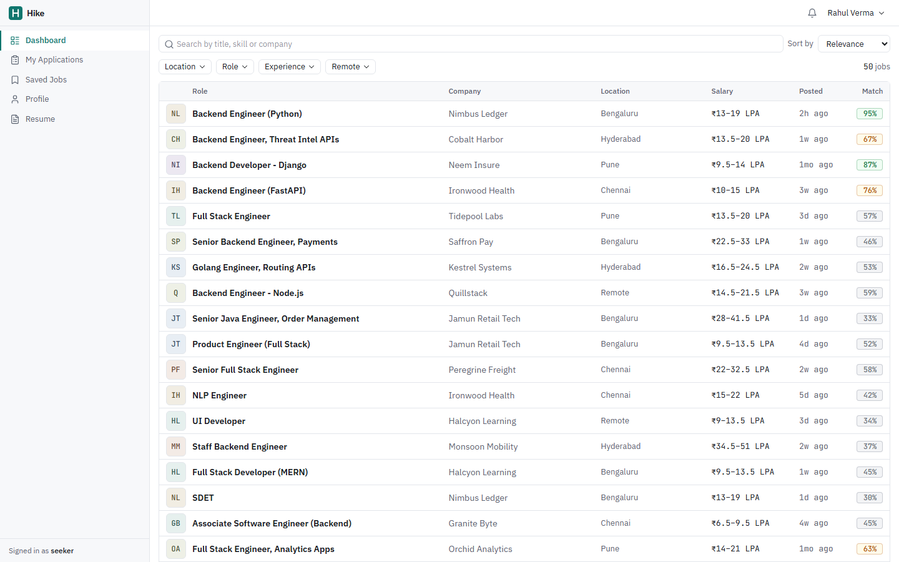
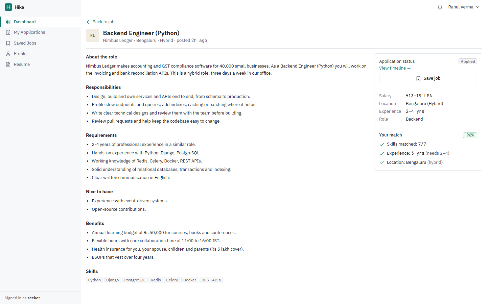
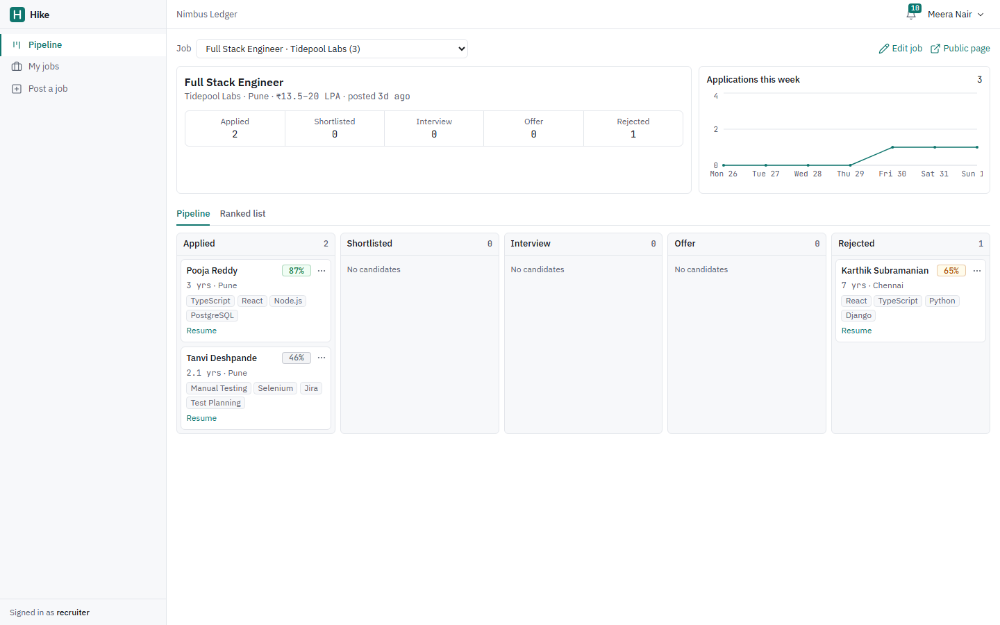
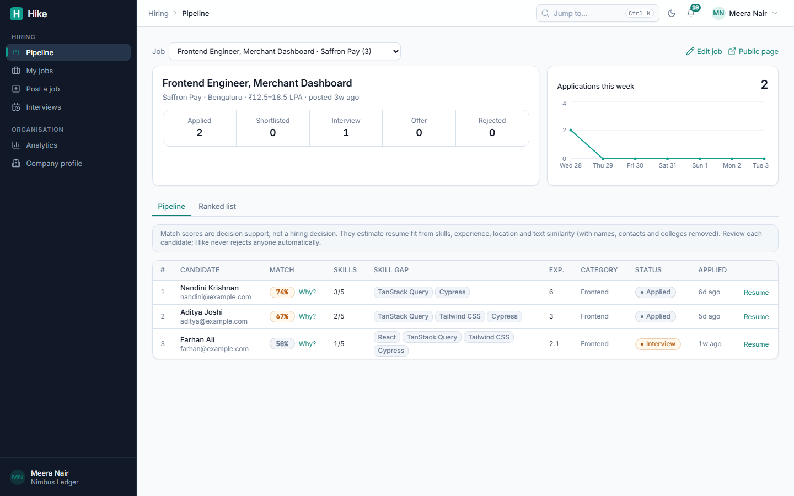
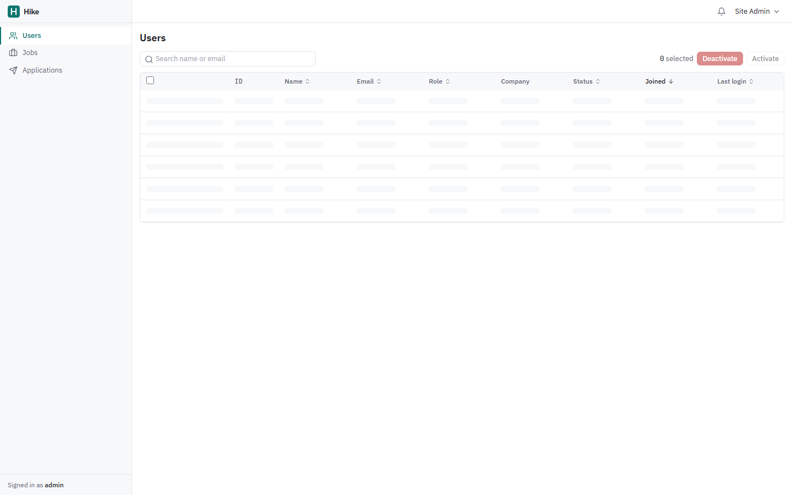
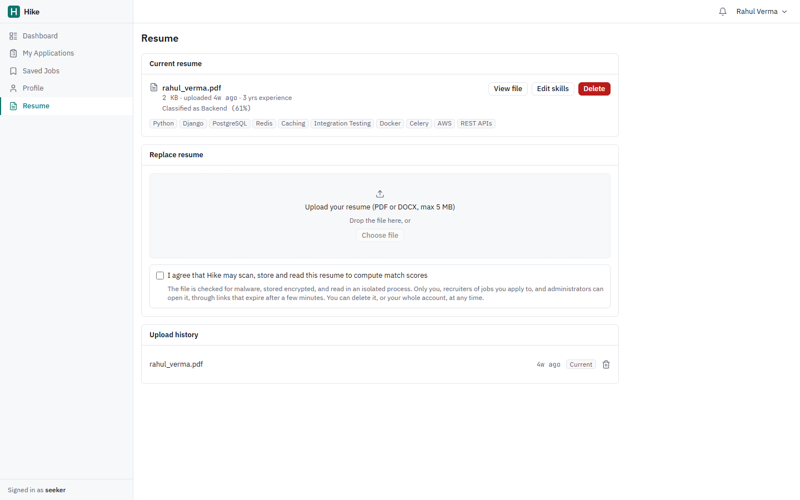
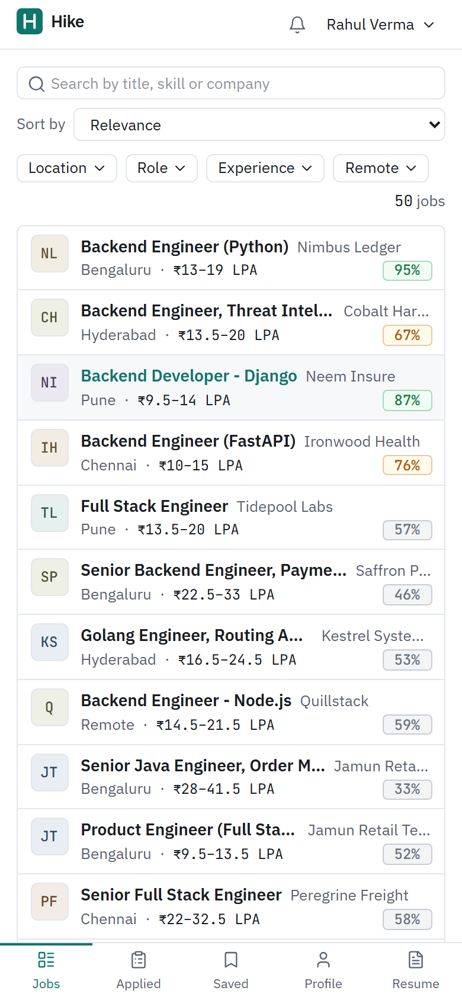
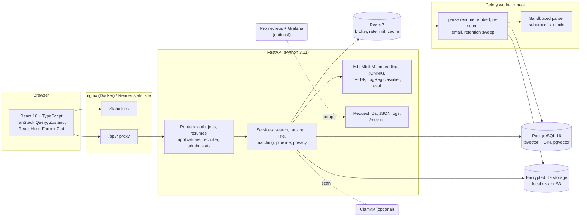

# Hike

A job portal and recruitment platform. Job seekers search and filter jobs, upload a resume that is parsed into skills and experience, and see a match score for every job with the reasons behind it. Recruiters post jobs, see candidates ranked by match score, and move them through a hiring pipeline on a drag-and-drop board. Admins manage users and jobs.

Built with FastAPI, PostgreSQL (full-text search + pgvector), Redis, Celery, sentence-transformers / ONNX Runtime, scikit-learn, React 18 and TypeScript. Resumes are uploaded only with consent, screened for malware, parsed in a sandboxed process, encrypted at rest and deletable at any time. The service exports Prometheus metrics and structured logs.



- **Live demo:** https://hike-web-a3qk.onrender.com (Render free plan: the first visit after 15 idle minutes takes about a minute to wake up). Sign in as `rahul@example.com` / `Seeker@123`, `rohan@example.com` / `Recruiter@123` or `admin@example.com` / `Admin@123`.
- **Demo video:** [docs/demo/hike-demo.webm](docs/demo/hike-demo.webm)
- **API docs:** `/api/docs` (FastAPI Swagger UI) on any running instance, e.g. http://localhost:8080/api/docs
- **Author:** Sai Pavan ([@Saipavanavsp](https://github.com/Saipavanavsp))

## Contents

- [Features](#features)
- [Screenshots](#screenshots)
- [Architecture](#architecture)
- [Matching algorithm](#matching-algorithm)
- [Search ranking](#search-ranking)
- [Fair and explainable matching](#fair-and-explainable-matching)
- [Background jobs](#background-jobs)
- [Resume privacy and security](#resume-privacy-and-security)
- [Observability](#observability)
- [Reliability and disaster recovery](#reliability-and-disaster-recovery)
- [Security hardening](#security-hardening)
- [Load testing](#load-testing)
- [Evaluation](#evaluation)
- [Engineering documentation](#engineering-documentation)
- [Run locally](#run-locally)
- [Demo accounts](#demo-accounts)
- [Tests](#tests)
- [Deployment](#deployment)
- [Project layout](#project-layout)

## Features

**Job seekers**
- Search with PostgreSQL full-text search (title, company, skills, description), title/skill autocomplete from an in-memory Trie, filters (location, role, experience, remote) and sorting (relevance, newest, salary, match %). 20 results per page; filters live in the URL.
- Resume upload (PDF or DOCX, max 5 MB) after an explicit consent checkbox. Extension, MIME and magic-byte checks and a malware screen run at upload; text extraction (pdfplumber / python-docx) runs in a background task inside a resource-limited subprocess. Skills, years of experience, education, email and phone are parsed, and the seeker reviews and corrects them before saving.
- Delete any resume, or the whole account, permanently (files, extracted text, embeddings, cached scores).
- Match score (0-100) on every job, with a text breakdown: skills matched (e.g. 7/9) plus the missing skills, experience fit and location fit.
- "How this score is calculated": every component with its points, for example "Required skills 28.0 / 35 · 8 of 10 required skills".
- Apply with an optional note; track status and a timeline of every change; save jobs; in-app notifications.
- Upcoming interviews with a calendar file (.ics) and an "Add to Google Calendar" link.
- Saved searches with job alerts: when a matching job is posted, the seeker is notified in the app and by email.
- Email notifications for application updates, interview invitations and job alerts, with an opt-out switch on the profile.
- Company pages: about, industry, size, website and open jobs.

**Recruiters**
- Post, edit, close and reopen jobs (markdown descriptions).
- Kanban pipeline per job: Applied / Shortlisted / Interview / Offer / Rejected, built with dnd-kit. Usable with keyboard (Space to pick up, arrows to move) and through each card's menu. Invalid moves (e.g. Applied to Offer) are blocked on the client and the server.
- Ranked list of candidates by match score, with a skill-gap column and a "Why?" breakdown of every score component. Resumes open through short-lived signed links. An "Applications this week" line chart.
- A notice on the pipeline says the score is decision support, not a hiring decision. Nothing is rejected automatically.
- Interview scheduling from a candidate's card: date, time, format and link. The candidate gets an email with a calendar invite; rescheduling and cancelling update the same calendar event.
- Analytics: hiring funnel with stage-to-stage conversion, offer rate, median time to first response, median time to offer, average days in each stage, and per-job results.
- Company profile editor (about, website, industry, size, headquarters).

**Admins**
- Users, jobs and applications tables with search, column sorting, pagination, checkbox bulk actions (deactivate/activate users, close jobs) and a confirmation dialog.
- System page: Postgres/Redis/worker/ClamAV health, queue depth, background task counts, recent failures, security and retention settings, and a "run retention now" button.
- Audit log of sensitive actions, with request ID and IP, filterable by actor and action. It covers:
  - sign-ins and failed sign-ins;
  - admin bulk actions and retention runs;
  - pipeline moves;
  - job changes and company profile edits;
  - interviews;
  - every time someone other than the owner opens a resume;
  - resume and account deletion.

**Platform**
- JWT access tokens (15 min, in memory only) and rotating refresh tokens (7 days, httpOnly cookie, stored hashed; reuse of a rotated token revokes the whole token family).
- Role guards return 401 for unknown callers and 403 for authenticated users without permission.
- Login rate limit in Redis: 5 failed attempts per email + IP per 15 minutes.
- Search results cached in Redis for 60 s; one version counter invalidates every cached search when any job changes.
- Celery worker for resume parsing, embeddings, bulk re-scoring, email delivery and the retention sweep, with retries and a status row per task.
- JSON logs with request IDs, Prometheus `/metrics`, optional Sentry, alert rules and a Grafana dashboard.

## Screenshots

| | |
|---|---|
|  |  |
| Job detail with the match breakdown | Recruiter pipeline (kanban) and weekly chart |
|  |  |
| Candidates ranked by match score with skill gaps | Admin users table with bulk actions |
|  |  |
| Parsed resume and predicted role category | Mobile: bottom tab bar and two-line rows |

All screenshots are of the running app with the seed data, captured by Playwright (`e2e/tests/screenshots.spec.ts`).

## Architecture



The SPA calls the API on the same origin (`/api/...`): the Vite dev server, nginx in Docker and a Render rewrite rule all proxy it. That keeps the refresh-token cookie first-party (`SameSite=Lax`, `HttpOnly`, `Secure` in production) without third-party cookie problems.

**Database schema (main tables):** `users`, `refresh_tokens`, `seeker_profiles`, `recruiter_profiles`, `companies`, `jobs` (with `search_vector tsvector` maintained by a trigger and `embedding vector(384)`), `saved_jobs`, `resumes` (processing status, consent time and version, file hash, scan result, parsed JSON, confirmed skills, embedding, predicted category; partial unique index for one current resume per seeker), `match_scores` (cached breakdowns keyed by resume and job signatures), `applications` (unique on job + seeker; `resume_id` is set to NULL if the seeker deletes that resume), `application_status_history`, `notifications` (with `emailed_at`), `background_tasks`, `interviews` (with an iCalendar sequence number), `saved_searches`, `audit_logs` (actor set to NULL when an account is deleted), `eval_runs`. Migrations are in `backend/alembic/versions`.

## Matching algorithm

`backend/app/services/matching.py`

```
score = 100 × (0.50 × semantic + 0.35 × skill_overlap + 0.10 × experience_fit + 0.05 × location_fit)
```

| Component | How it is computed |
|---|---|
| semantic | Cosine similarity between `all-MiniLM-L6-v2` embeddings of the resume text and the job (title + skills + description). Long documents are split into ~180-word windows (the model truncates at 256 word pieces), and the window vectors are averaged and re-normalised. The raw cosine is rescaled linearly from [0.15, 0.65] to [0, 1]: whole-document MiniLM cosines sit in a narrow band (on the eval set, relevant pairs have a median of 0.46 and non-relevant pairs 0.34), so without rescaling a perfect candidate could not score above ~35/50 on this component. |
| skill_overlap | Required job skills found in the resume's confirmed skills ÷ required skills. Both sides go through the skills taxonomy, so "Postgres" matches "PostgreSQL". |
| experience_fit | 1 inside [min, max]; −0.5 per year below the minimum; −0.1 per year above the maximum, floored at 0.6 (overqualified is a soft mismatch); 0.5 if unknown. |
| location_fit | 1 if the job is remote and the seeker is open to remote, or the job city is one of the seeker's cities (current or preferred), or the seeker set none; otherwise 0. |

The API returns `{score, skills_matched, skills_missing, skills_ratio: "7/9", experience_ok, location_ok, ...}`, and the UI shows it as text, not a gauge.

**Embeddings in production.** `sentence-transformers` needs PyTorch (~500 MB RAM), which does not fit a 512 MB free instance. Production uses the official ONNX export of the same model with `onnxruntime` + `tokenizers` and identical mean pooling. `tests/test_embeddings.py` asserts that the ONNX vectors match the sentence-transformers reference to within 1e-4 (measured max difference: 1.1e-7). Set `EMBEDDING_BACKEND=sentence-transformers` to use the reference library.

**Caching.** Job and resume embeddings are stored in Postgres (`vector(384)`) with a content hash, and recomputed only when the text changes. Match breakdowns are cached in `match_scores`, keyed by a signature of the resume (embedding hash, skills, years, location preferences) and of the job (embedding hash, skills, experience, location). Editing a profile or job invalidates only the affected rows. The model is loaded once at startup.

**Skills extraction.** `backend/app/ml/data/skills_taxonomy.json` has 309 skills with aliases ("JS" → JavaScript, "k8s" → Kubernetes, "sklearn" → scikit-learn). Text and aliases go through the same tokenizer, and matching is greedy longest-n-gram (up to 4 tokens), so "React Native" wins over "React". Words that are also common English ("Go", "Swift", "Spring", "R") only match their exact capitalised form.

**Role classifier.** TF-IDF (word 1-2 grams) + logistic regression predicts Backend / Frontend / Full-Stack / Data-ML / DevOps / Mobile / QA from resume text. The prediction is shown to the seeker and recruiter, is filterable in the recruiter API, and is a small signal in search ranking.

## Search ranking

`backend/app/services/ranking.py` and `search.py`

PostgreSQL does the filtering and the full-text match against a weighted `tsvector` (title A, company and skills B, description C; GIN index). Before the query runs, `services/query_understanding.py` rewrites it:
- **Typo correction.** A word that matches no open job is replaced by the closest word in the job vocabulary. The vocabulary is a materialized view of title words and skills; the match uses `pg_trgm` similarity plus `fuzzystrmatch` edit distance, the same first letter, and at most 1–2 edits. So "pyhton developer" becomes "python developer", and the UI shows "Showing results for …".
- **Synonyms.** Words and phrases expand to OR groups from `app/ml/data/search_synonyms.json`: "js" also matches JavaScript, "k8s" Kubernetes, "sde" software engineer.
- **Semantic candidates.** A job whose MiniLM cosine with the query is at least 0.45 is a candidate even if it shares no words with the query.

Up to 1,000 candidates come back in one SQL query with `ts_rank_cd` and the cosine, and they are cached in Redis. The "relevance" order is then computed in Python:

```
score = 0.45 × text_relevance + 0.35 × match + 0.15 × recency + 0.05 × category_fit
```

- `text_relevance` = 0.6 × lexical + 0.4 × semantic. Lexical is `ts_rank_cd / (ts_rank_cd + 1)`, squashing the unbounded rank into [0, 1). Semantic is the query/job cosine rescaled to [0, 1].
- **Effect, measured on 37 labelled queries** ([docs/search-evaluation.md](docs/search-evaluation.md)):
  - NDCG@10 goes from 0.404 to 0.787. The paired 95% CI for the gain is +0.25 to +0.53.
  - Zero-result queries drop from 49% to 5%.
  - Nearly all of the gain comes from synonyms and typo correction. The semantic signal adds +0.002, and the report says so.
- `match` = match score / 100 for the signed-in seeker.
- `recency` = `exp(−ln 2 × age_days / 14)`: 1.0 today, 0.5 at two weeks, 0.25 at four.
- `category_fit` = 1 if the job's role category equals the category predicted for the seeker's resume.

When a signal is unavailable (no search text, no resume), its weight is dropped and the remaining weights are renormalised.

**Complexity.** For n filtered candidates and page p of size s, scoring is O(n), and the best k = p·s are selected with a heap (`heapq.nlargest`) in O(n log k) instead of sorting everything in O(n log n). Match scores for the candidates come from the `match_scores` cache; only stale pairs are recomputed, as one batched dot product per job.

**Autocomplete Trie** (`services/trie.py`). Each job title and skill is inserted under every word start, so "back" finds "Senior Backend Engineer". Terminal nodes store how many open jobs use the term. A query walks the prefix in O(P), collects the M terms below it, and picks the top k by frequency in O(M log k). Each API worker keeps its own Trie and rebuilds it lazily when the shared jobs version counter in Redis changes.

## Fair and explainable matching

- **Every component is shown.** The API returns `components`: label, points earned, weight and the reason, for example "8 of 10 required skills" or "3 yrs; job asks 2-5 yrs". Seekers see it on each job; recruiters see it under "Why?" in the ranked list.
- **Candidates correct what the parser got wrong.** Skills and years are reviewed and confirmed before any score is computed.
- **Identity is removed before the text comparison.** The embedding and the role classifier see the resume with the candidate's name, email, phone, links and institution names removed (`services/redaction.py`). Skills, experience and location are still read from the full text, and recruiters still see the original resume.
- **The removal was added because a test found a real bias.** The holdout evaluation rescores every resume after changing only the name (fictional names linked with different genders, regions and religions) or only the college:

  | Swap | Before redaction: max change / top-5 changed | After redaction: max change / top-5 changed |
  |---|---|---|
  | Name | 9 points / 20% of variants | 0 points / 0% |
  | Institution | 4 points / 13% of variants | 2 points / 0% |

  A test keeps it that way. This is a counterfactual check on fictional data; there is no consented demographic data, so outcomes for real candidate groups are not measured.
- **Decision support only.** The recruiter pipeline says so, and no candidate is filtered out or rejected by the system.

## Background jobs

`backend/app/worker.py`, `backend/app/tasks/`

Slow or failure-prone work runs in a Celery worker, with Redis as the broker:

| Task | Triggered by |
|---|---|
| `process_resume`: sandboxed text extraction + field parsing | every upload (the API answers `202 Accepted`; the UI polls until the resume is `ready` or `failed`) |
| `derive_resume`: MiniLM embedding + role classification | the seeker confirming a resume |
| `embed_job`, `score_job_candidates` (bulk matching) | a job being created or edited |
| `deliver_email` | every notification, unless the user turned email off. `EMAIL_BACKEND=log` (default) writes it to the `hike.email` log; `EMAIL_BACKEND=smtp` sends it through any SMTP provider. Interview emails carry an `.ics` invite. |
| `saved_search_alerts` | a job being posted or reopened (checked against every saved search, using the search page's own filters) |
| `retention_sweep` | daily at 03:00 UTC (Celery beat), or an admin button |

Each task gets a row in `background_tasks` (queued → running → retrying → succeeded / rejected / failed, attempts, error, timestamps). `GET /api/tasks/{id}` shows its status to its owner. Any exception is retried 3 times with exponential backoff and jitter. A `PermanentError` ends the task at once as `rejected` instead: an unreadable file is the user's input problem, not an outage. When retries run out, the task is marked `failed`, logged at ERROR with `alert=true`, sent to Sentry if configured, and reported to admins in the app (at most once per task type per hour). The resume being processed is also flagged so the seeker sees an error. If Redis is unreachable when a task is queued, the API runs it inline instead of losing it.

With `TASKS_EAGER=true` there is no worker at all: tasks run inline in the API process. Tests use this mode, and so does the Render free plan, which has no background workers.

## Resume privacy and security

| Control | Where |
|---|---|
| **Consent.** Upload requires an explicit checkbox; the time and policy version are stored on the resume. The API refuses uploads without `consent=true`. | `services/resumes.py`, `ResumePage.tsx` |
| **Malware screening** before anything is stored. Built-in checks always run: PDF JavaScript, launch actions, embedded files (including `#xx`-escaped names and names inside compressed object streams), DOCX macros, ActiveX, embedded OLE objects, remote templates, zip bombs, and the EICAR test signature. With `MALWARE_SCAN=clamav` the file is also streamed to a ClamAV daemon; if ClamAV is unreachable the upload fails with 503 rather than skipping the scan. | `services/file_scan.py` |
| **Isolated parsing.** PDF/DOCX parsing runs in a separate `python -I` process with no secrets in its environment, a wall-clock timeout, and (on Linux) address-space, CPU and core-dump limits. A crafted file that hangs or exhausts memory is reported as unreadable instead of taking the worker down. | `services/doc_extract.py` |
| **Encryption at rest.** Files are encrypted with Fernet (AES-128-CBC + HMAC-SHA256) before they reach local disk or S3. | `services/storage.py` |
| **Signed, expiring downloads.** The app requests a link (`POST /api/resumes/{id}/link`) that names the resume, the viewer and an expiry time, signed with HMAC-SHA256 (5 minutes by default). Access is re-checked when the link is used, so a deactivated recruiter's links stop working. Responses are `no-store` and `nosniff`. | `core/signing.py`, `api/resumes.py` |
| **Deletion.** `DELETE /api/resumes/{id}` and `POST /api/account/delete` (password required) remove the files, extracted text, embeddings and cached scores. Applications made with a deleted resume stay for the recruiter but no longer link to any resume data. | `services/resumes.py` |
| **Retention.** Unsaved or failed uploads are removed after 7 days and superseded resumes after 365 days; inactive seeker accounts can be removed after N days (off by default). | `services/retention.py` |
| **Decision support only.** Recruiters see every candidate with the score breakdown; nothing is filtered out or rejected automatically. | `RankedTable.tsx`, `KanbanBoard.tsx` |

Limits: the built-in checks are heuristics, not an antivirus engine; turn on ClamAV for real signature scanning. On Windows only the parser's timeout applies (resource limits are POSIX).

## Observability

- **Logs:** one JSON object per line (`LOG_FORMAT=json`) with `request_id`, plus `method`, `route`, `status` and `duration_ms` on every access line. Worker log lines carry the task ID.
- **Request IDs:** every response has `X-Request-ID` (the caller's, if it looks safe, else a new one). Unhandled errors return `{"detail": "Internal server error", "request_id": ...}` with no internals, and the stack trace is logged under the same ID.
- **Metrics:** `GET /metrics` (Prometheus; set `METRICS_TOKEN` to require a bearer token):
  - `hike_http_requests_total{method,route,status}` and `hike_http_request_duration_seconds` (by route template, so cardinality stays bounded)
  - `hike_dependency_up{name}` and `hike_dependency_latency_ms{name}` for Postgres and Redis
  - `hike_worker_up` (from the worker's heartbeat), `hike_queue_depth`, and `hike_background_tasks_last_hour{status}`
- **Health:** `/health` returns 503 if Postgres or Redis is down, and reports the worker, queue depth and latencies.
- **Alerts and dashboard:** `docker compose --profile monitoring up` adds Prometheus (http://localhost:9090) with seven alert rules (`ops/prometheus/alerts.yml`): API down, dependency down, worker down, failed background tasks, queue backlog, 5xx rate above 5%, p95 latency above 1 s. It also adds Grafana (http://localhost:3000) with a provisioned dashboard.
- **Errors:** set `SENTRY_DSN` to send exceptions and failed tasks to Sentry (no personal data is sent).

## Reliability and disaster recovery

- **Backups:**
  - The `backup` service writes a daily `pg_dump`.
  - Each dump is checked with `pg_restore --list` and given a checksum; 7 days are kept.
  - `ops/backup/verify-restore.sh` restores the latest dump into a scratch database and compares every table's row count and the migration revision with the live database.
  - CI runs that restore check on every push to `main`. Runbook: [docs/runbooks/backup-restore.md](docs/runbooks/backup-restore.md).
- **Dead letter:**
  - A task that still fails after its retries stays `failed` and counts toward `hike_dead_letter_tasks`, which has an alert.
  - Admins see it on the System page and can retry it (audited). A failed resume parse is reset and processed again.
- **Idempotency:**
  - Resume parsing and email delivery lock their row (`FOR UPDATE SKIP LOCKED`).
  - Emails carry a stable `Message-ID` so mail clients can drop a duplicate.
  - Saved-search alerts are deduplicated.
  - Tests run each task twice, and concurrently.
- **Graceful shutdown and recovery:**
  - On shutdown, the API finishes in-flight requests (25 s) and the worker finishes its current tasks.
  - `acks_late` redelivers tasks from a worker that died.
  - On start, the worker re-dispatches tasks left `queued` or `running` for 10 minutes.
  - Verified by stopping the worker, uploading a resume, and starting the worker again: the resume was parsed as soon as the worker came back.

## Security hardening

- **CSRF:** the cookie endpoints (login, register, refresh, logout) require an `X-CSRF-Protection` header and check `Origin`, on top of `SameSite=Lax` (`app/core/csrf.py`).
- **Headers:**
  - The API sends CSP `default-src 'none'`, nosniff, `X-Frame-Options: DENY`, Referrer-Policy and Permissions-Policy, plus HSTS on HTTPS and `no-store` on auth responses.
  - The website (nginx and the Render static site) sends a CSP with `script-src 'self'` and `frame-ancestors 'none'`.
  - A browser sweep of 18 pages across all roles found no CSP violations.
- **Access control:** `tests/test_access_control.py` holds a table of who may call each of the 67 routes, and checks every route as anonymous, seeker, recruiter and admin. It fails if a new route is not in the table, and also tests cross-account access to jobs, applications, interviews, resumes, saved searches and tasks.
- **Upload and download attacks:** tests cover:
  - hostile filenames (path traversal, quotes, CRLF header injection);
  - HTML hidden in a PDF;
  - signed links tampered to point at another resume or a later expiry;
  - EICAR, macros, zip bombs and sandbox limits.
- **Scanning** (`.github/workflows/security.yml`, on every push and weekly):
  - `pip-audit` on the backend.
  - `npm audit`, which fails on high-severity issues in shipped frontend code.
  - Trivy on both Docker images, failing on fixable HIGH/CRITICAL findings.
- **What the scans fixed:**
  - Upgraded react-router (open redirect) and zod.
  - Pinned msgpack, urllib3 and setuptools.
  - Removed pip from the runtime image, because its bundled libraries were flagged.
  - Updated the nginx Alpine base. Both images now scan clean.
- **Threat model:** [docs/threat-model.md](docs/threat-model.md).

## Load testing

Locust scenarios in `loadtest/` include searching, job pages, autocomplete, signed-in seekers, recruiters loading ranked pipelines, and resume uploads parsed by the worker. Full report: [docs/load-testing.md](docs/load-testing.md). Everything ran on one laptop:

| Concurrent users | Req/s | Errors | p50 | p95 | p99 | Search cache hits |
|---|---|---|---|---|---|---|
| 100 | 44.7 | 0% | 9 ms | 24 ms | 72 ms | 76% |
| 250 | 112.2 | 0% | 10 ms | 32 ms | 75 ms | 86% |
| 500 | 218.3 | 0% | 67 ms | 230 ms | 290 ms | 91% |

The first run deadlocked the API at 500 users (96% errors), and it stayed hung until restarted:
- **Cause:** the 40-thread pool waited for 15 pooled connections, while the requests holding those connections waited for a thread.
- **Fix:**
  - an async session dependency;
  - a concurrency limit that answers `503 Retry-After` when saturated;
  - a database pool sized for two sessions per running request.
- **Records:** [ADR 0008](docs/adr/0008-load-shedding.md) and the before/after table in the report.

At 500 users PostgreSQL used at most 18 connections. Resume upload-to-parsed stayed under 1.2 s at p95.

## Evaluation

Full report: **[docs/evaluation.md](docs/evaluation.md)**. It is generated from the result files, and a test fails if it goes stale.

There are two evaluations:

1. **Holdout set** (`backend/eval/holdout`): 24 resumes and 34 jobs written by hand, separate from the seed data and including 6 non-software distractor jobs.
   - Every resume is rendered in one of four document layouts and read by the production parser.
   - Labels are graded: 2 = strong fit, 1 = partial fit.
2. **Synthetic seed set**: 20 resumes × 50 jobs from the seed generator, with labels from a rule. The system was developed against this set.

```powershell
cd backend
.\.venv\Scripts\python -m app.ml.eval                   # synthetic set (also runs during seeding)
.\.venv\Scripts\python -m app.ml.eval_holdout --report  # holdout set + docs/evaluation.md
```

**Holdout results** (mean over resumes, with 95% bootstrap intervals):

| Method | P@5 | R@5 | MRR | NDCG@5 |
|---|---|---|---|---|
| TF-IDF cosine (baseline) | 0.517 (0.44–0.60) | 0.926 | 1.000 | 0.961 (0.93–0.98) |
| MiniLM embeddings only | 0.467 (0.41–0.53) | 0.851 | 1.000 | 0.926 (0.90–0.96) |
| Hike hybrid score | 0.525 (0.45–0.60) | 0.936 | 1.000 | 0.965 (0.94–0.99) |

What this shows, honestly:
- **Hike vs MiniLM alone:** the hybrid score is clearly better. NDCG@5 is +0.038 (paired 95% CI +0.013 to +0.062).
- **Hike vs TF-IDF:** there is no clear difference (+0.004, CI −0.012 to +0.020). On the synthetic set TF-IDF is ahead.
- **P@5 ceiling:** the best possible P@5 here is 0.575, because most resumes have fewer than five acceptable jobs. MRR is 1.0 for every method, so this set is too easy at rank 1.
- **Two-column PDFs are the weak spot:**
  - The parser never finds the name.
  - It misses total experience by about a year.
  - The same resume in four layouts moves its scores by 3.3 points out of 100 on average.
  - Seekers confirm or correct the parsed years and skills before matching, which mitigates this.
- **Caveats:**
  - The data is fictional and small.
  - The labels were drafted with AI assistance under a written rubric and have not been reviewed by an independent labeller.
  - The rubric partly rewards skill overlap, which flatters Hike.
  - The report lists these limits and what a real-world evaluation would need (consented anonymised resumes, two labellers, Cohen's kappa). The harness can export and import labels for that review.

**Synthetic set:**

| Method | Precision@5 | Recall@5 | MRR | NDCG@5 | Accuracy* |
|---|---|---|---|---|---|
| TF-IDF cosine (baseline) | **0.760** | **0.669** | 1.000 | **0.838** | **0.933** |
| MiniLM embeddings cosine only | 0.710 | 0.619 | 1.000 | 0.807 | 0.923 |
| Hike match score (full formula) | 0.740 | 0.648 | 1.000 | 0.836 | 0.929 |

\* Accuracy of the decision "the top-5 jobs per resume are relevant, the rest are not" over all 1,000 pairs (119 relevant). The synthetic jobs and resumes come from the same templates and share vocabulary, which favours exact term overlap.

**Role classifier**

| Evaluation | Samples | Accuracy |
|---|---|---|
| 5-fold stratified CV on the training set | 280 | 1.000 (macro F1 1.000) |
| Held-out: the 20 seed resumes | 20 | 1.000 |

Confusion matrix on the 20 seed resumes (rows = true, columns = predicted: backend, frontend, fullstack, data_ml, devops, mobile, qa):

```
backend    [4, 0, 0, 0, 0, 0, 0]
frontend   [0, 3, 0, 0, 0, 0, 0]
fullstack  [0, 0, 3, 0, 0, 0, 0]
data_ml    [0, 0, 0, 4, 0, 0, 0]
devops     [0, 0, 0, 0, 2, 0, 0]
mobile     [0, 0, 0, 0, 0, 2, 0]
qa         [0, 0, 0, 0, 0, 0, 2]
```

Perfect scores here mean the task is easy on synthetic data. The training texts are generated from templates (`seed/build_classifier_data.py`), and the seed resumes use clear role vocabulary. Expect lower accuracy on real resumes, especially Full-Stack versus Frontend/Backend.

## Engineering documentation

| Document | Contents |
|---|---|
| [docs/adr/](docs/adr/README.md) | 8 Architecture Decision Records: monolith + worker, PostgreSQL for search and vectors, ONNX embeddings, Celery task tracking, JWT + rotating refresh cookie, encrypted storage + signed links, identity redaction, load shedding |
| [docs/architecture.md](docs/architecture.md) | ER diagram of every table; sequence diagrams for sign-in and refresh rotation, the resume pipeline, search, applying and email, interview scheduling, and the request path inside the API |
| [docs/threat-model.md](docs/threat-model.md) | STRIDE per trust boundary: threat, mitigation, code location, test; residual risks |
| [docs/load-testing.md](docs/load-testing.md) | 100/250/500-user results, the deadlock found and fixed, bottlenecks |
| [docs/evaluation.md](docs/evaluation.md), [docs/search-evaluation.md](docs/search-evaluation.md) | Matching and search relevance evaluations |
| [docs/runbooks/](docs/runbooks/deployment.md) | Deployment, post-deploy smoke test, restart/redeploy verification, backup and restore |
| [docs/demo/hike-demo.webm](docs/demo/hike-demo.webm) | 47-second captioned walkthrough of the seeker, recruiter and admin workflows, recorded with Playwright (`e2e/tests/demo.spec.ts`) |

## Run locally

**Requirements:** Docker Desktop. That is all you need for the full app.

```powershell
git clone https://github.com/Saipavanavsp/hike.git
cd hike
docker compose up --build
```

The first build takes a few minutes (it downloads the ONNX model). On first start the backend runs migrations, seeds the demo data and runs the evaluation (about 30 s). The `worker` container then starts processing background tasks, and the stack serves:

- App: http://localhost:8080
- API docs: http://localhost:8080/api/docs
- API directly: http://localhost:8000 (`/health`, `/metrics`)

Optional profiles:

```powershell
# ClamAV malware scanning (first start downloads signatures: ~2 minutes, ~1.2 GB RAM)
$env:MALWARE_SCAN = "clamav"; docker compose --profile security up --build
# Prometheus (:9090) with alert rules + Grafana (:3000) with a dashboard
docker compose --profile monitoring up --build
```

To start over with fresh data: `docker compose down -v`, then `docker compose up --build`.

**Developing without Docker for the app code** (Postgres and Redis still run in Docker). Needs Python 3.11+ and Node 20+.

```powershell
docker compose up -d postgres redis

# backend
cd backend
python -m venv .venv
.\.venv\Scripts\python -m pip install -r requirements-dev.txt
Copy-Item .env.example .env
.\.venv\Scripts\alembic upgrade head
.\.venv\Scripts\python -m seed.seed --reset
.\.venv\Scripts\uvicorn app.main:app --reload --port 8000

# frontend (second terminal)
cd frontend
npm install
npm run dev          # http://localhost:5173, proxies /api to :8000
```

## Demo accounts

| Role | Email | Password |
|---|---|---|
| Admin | admin@example.com | Admin@123 |
| Recruiter | meera@example.com | Recruiter@123 |
| Recruiter | rohan@example.com | Recruiter@123 |
| Recruiter | ananya@example.com | Recruiter@123 |
| Seeker (Backend) | rahul@example.com | Seeker@123 |
| Seeker (Frontend) | aditya@example.com | Seeker@123 |
| Seeker (Full-Stack) | pooja@example.com | Seeker@123 |
| Seeker (Data/ML) | vikram@example.com | Seeker@123 |
| Seeker (Mobile) | aman@example.com | Seeker@123 |

The other 15 seeded seekers use `<firstname>@example.com` with the same password. All companies, people and resumes are fictional.

## Tests

| Suite | Command | What it covers |
|---|---|---|
| Backend (PyTest) | `cd backend; .\.venv\Scripts\python -m pytest --cov=app` | 294 tests: auth (rotation, reuse detection, rate limit, 401 vs 403), search/filters/sort/pagination/cache invalidation, Trie, ranking, resume parsing, skills taxonomy, embeddings (ONNX vs reference), matching and its cache, classifier, both eval harnesses (including a check that the committed numbers and report reproduce), applications pipeline, admin, seed. Background tasks: retries, permanent failures, alerts, queue-down fallback, email delivery, bulk re-scoring. Security: malware heuristics, a fake clamd server (clean, infected, unreachable = 503), sandboxed parsing (timeout, memory limit, no secrets in the child), encryption at rest, signed URL tampering, expiry and revocation. Privacy: resume and account deletion, retention rules. Observability: request IDs, JSON 500s, metrics, health. Features: score components, identity redaction and the fairness regression guard, interviews (stage rule, time checks, permissions, reschedule/cancel, `.ics` content and line folding), SMTP email with the invite attached (fake SMTP server), email opt-out, saved searches and alerts, the analytics funnel and timings, company pages, and the audit log (including anonymised entries after account deletion). Reliability: dead-letter retry, idempotent parsing and email (concurrent duplicates), stale-task recovery. Hardening: every route checked for every role, cross-account access, CSRF, security headers, hostile filenames, load shedding. Search: typo correction, synonyms, hybrid score, and the search evaluation reproducing. Needs Postgres and Redis (`docker compose up -d postgres redis`). One test (parser memory limit) runs on Linux only. |
| Frontend (Vitest + RTL) | `cd frontend; npm test` | 33 tests: score component table, interview scheduling only from the Interview column, MatchPill thresholds, filter chips, login/register validation, kanban moves and allowed transitions, a candidate whose resume was deleted, resume upload consent and the processing/failed states, formatting. |
| E2E (Playwright) | `cd e2e; npm ci; npx playwright install chromium; npx playwright test` | 20 tests against the running stack on :8080, with the real worker. Covered: typo correction and synonyms in the search UI; score components and the company page; scheduling an interview in the UI and the seeker downloading the `.ics` and opening the Google Calendar link; a saved search producing an alert when a matching job is posted; recruiter analytics; the admin audit log; the hiring flow (search, match breakdown, apply, recruiter shortlists, seeker sees the status); invalid login; role-based redirects; 401/403 across the API and a forged token; refresh-token reuse revoking the session; sign-out revoking the refresh token; deactivation ending a live session; upload failures (wrong type, oversize, fake PDF, EICAR, unreadable PDF processed by the worker); upload without consent; duplicate applications; invalid pipeline moves and cross-recruiter access; signed file links; resume deletion; account deletion; a recruiter's view after a resume is deleted. |

Backend coverage is 95% overall. Every module in `app/services`, `app/tasks` and `app/ml` is above 80% except three:
- `services/cache.py` (71%): Redis-down fallbacks.
- `services/doc_extract.py` (69%): its main path runs in the sandbox subprocess, which coverage does not measure, though the tests exercise it.
- `services/storage.py` (88%) covers everything except the S3 backend.

Lint: `ruff check . ; black --check .` (backend) and `npm run lint` (ESLint + Prettier, frontend).

Post-deploy smoke test: `node e2e/tools/smoke.cjs <url>`. The browser console sweep is `node e2e/tools/console-sweep.cjs`, and Mermaid diagrams are checked with `node e2e/tools/check-mermaid.cjs <files>`.

## Deployment

**CI/CD (GitHub Actions)**
- `.github/workflows/ci.yml` runs on every pull request and push to `main`: ruff, black, PyTest with coverage (Postgres + pgvector and Redis service containers), then ESLint, Prettier, Vitest and the production build.
- `.github/workflows/deploy.yml` runs on push to `main`:
  1. brings up the whole stack with `docker compose`;
  2. runs the Playwright suite;
  3. backs up and verifies a restore;
  4. calls the Render deploy hooks;
  5. smoke-tests the live site with `e2e/tools/smoke.cjs`, if the `SMOKE_URL` secret is set.
- `.github/workflows/security.yml`: dependency and container vulnerability scans (see [Security hardening](#security-hardening)).

**Render** (`render.yaml` blueprint):
- `hike-api`: Docker web service, health check `/health`.
- `hike-web`: static site with a `/api/*` rewrite to the API and an SPA fallback.
- `hike-db`: Postgres 16; the first migration creates pgvector.
- `hike-redis`: Key Value.

The API seeds itself on first start. Render generates `JWT_SECRET`, `FILE_ENCRYPTION_KEY` (keep it: changing it makes stored resumes unreadable) and `METRICS_TOKEN`.

The free plan has no background workers, so the blueprint sets `TASKS_EAGER=true`: tasks run inline, and the retention policy runs on every start. ClamAV needs about 1.2 GB of RAM, so the free deployment uses the built-in heuristic scan only.

**Production blueprint** (`deploy/render-production.yaml`, paid plans) deploys separately:
- the API (2 processes);
- a background worker;
- PostgreSQL with daily backups;
- Redis with `noeviction`, because it holds the queue;
- the static site.

Resumes go to an S3-compatible bucket (Cloudflare R2), encrypted by the app. The API and the worker share their secrets through an environment group. The runbook ([docs/runbooks/deployment.md](docs/runbooks/deployment.md)) covers storage setup, deploys, rollback, and the restart and redeploy verification. That verification ran locally with `docker compose --profile s3`: a resume stored before a restart and a full redeploy still decrypted to the original bytes.

One-time setup:
1. Push this repo to GitHub.
2. In Render: **New → Blueprint**, choose the repo, and apply `render.yaml`.
3. If Render assigned different hostnames than `hike-api.onrender.com` / `hike-web.onrender.com`, update `CORS_ORIGINS` on `hike-api` and the `/api/*` rewrite destination on `hike-web`.
4. For each of the two services, copy its **Deploy Hook** URL (Settings) into GitHub repo secrets `RENDER_DEPLOY_HOOK_API` and `RENDER_DEPLOY_HOOK_WEB`.

Free-tier notes: the API sleeps after 15 minutes idle (first request takes about a minute), free Postgres expires after 30 days, and the free web service has no persistent disk. Uploaded resumes survive restarts only with `STORAGE_BACKEND=s3` (any S3-compatible bucket such as Cloudflare R2; see `backend/.env.example`).

## Project layout

```
hike/
├── backend/
│   ├── app/
│   │   ├── api/        # routers: auth, jobs, resumes, applications, recruiter, admin, profile, stats, health
│   │   ├── core/       # settings, JWT/bcrypt, role guards, Redis, rate limiter, logging/metrics, URL signing
│   │   ├── models/     # SQLAlchemy 2.0 models
│   │   ├── schemas/    # Pydantic v2 schemas
│   │   ├── services/   # search, ranking, Trie, cache, parser, sandbox, malware scan, storage, matching, retention
│   │   ├── tasks/      # Celery task definitions and the tracking/retry layer
│   │   ├── worker.py   # Celery app and beat schedule
│   │   └── ml/         # embeddings, TF-IDF, classifier, skills taxonomy, eval harnesses, report
│   ├── alembic/        # migrations (incl. FTS trigger, pgvector)
│   ├── eval/holdout/   # holdout evaluation data: 34 jobs, 24 resumes in 4 layouts, graded labels
│   ├── seed/           # seed script, dataset builders, 20 resume PDFs, JSON data
│   └── tests/          # PyTest suites + fixture resumes
├── frontend/           # React + Vite + Tailwind (design tokens in tailwind.config.ts)
├── e2e/                # Playwright E2E + screenshot capture
├── ops/                # Prometheus config + alert rules, Grafana dashboard
├── docs/               # evaluation report, screenshots
├── docker-compose.yml
├── render.yaml
└── .github/workflows/
```

## License

MIT © Sai Pavan
