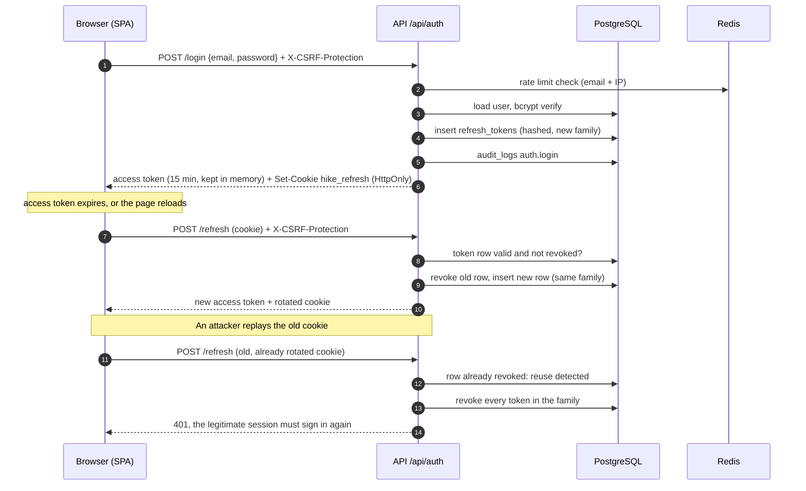
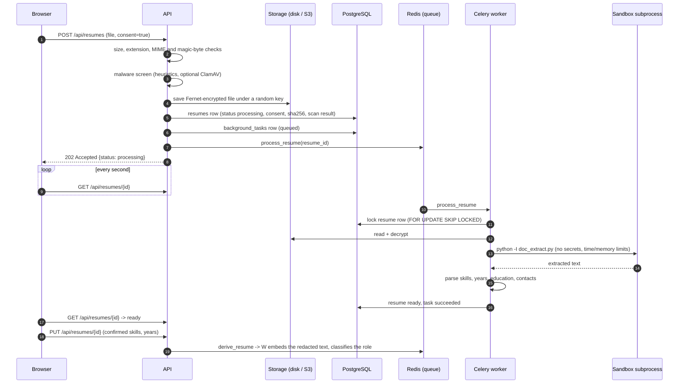
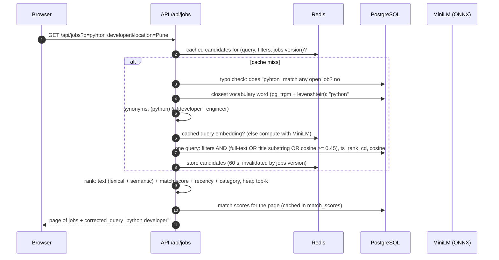
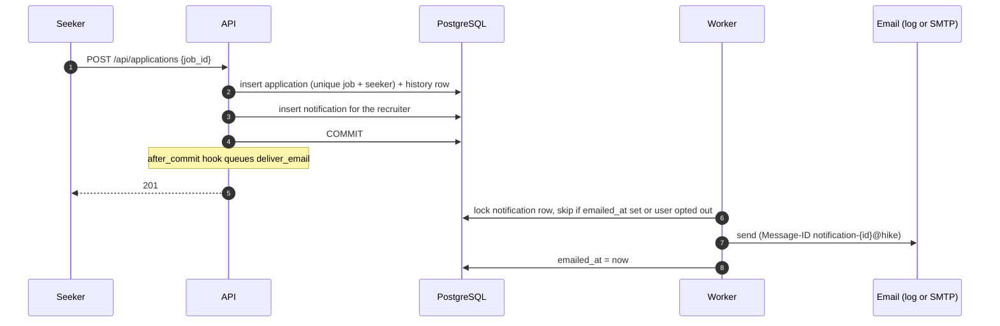
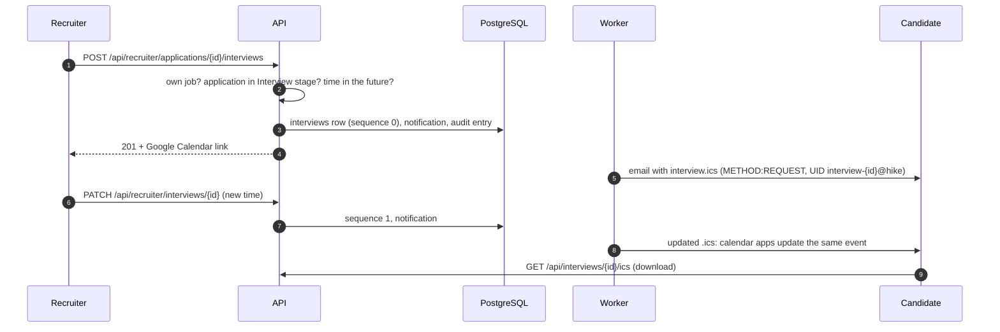
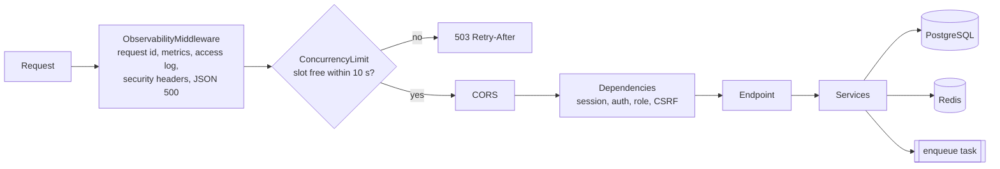

# Architecture

System overview: see the diagram in the [README](../README.md#architecture). Decisions and
their trade-offs: [docs/adr](adr/README.md). Threats and mitigations: [threat-model.md](threat-model.md).

- [Database (ER diagram)](#database)
- [Sign-in, refresh rotation and theft detection](#sign-in-refresh-rotation-and-theft-detection)
- [Resume upload and processing](#resume-upload-and-processing)
- [Search](#search)
- [Applying, notifications and email](#applying-notifications-and-email)
- [Interview scheduling](#interview-scheduling)
- [Request path inside the API](#request-path-inside-the-api)

## Database

PostgreSQL 16 with `pgvector`, `pg_trgm`, `fuzzystrmatch` and `citext`. Migrations:
`backend/alembic/versions` (0001-0009). Key columns only.

```mermaid
erDiagram
    users ||--o| seeker_profiles : has
    users ||--o| recruiter_profiles : has
    companies ||--o{ recruiter_profiles : employs
    users ||--o{ refresh_tokens : "signs in with"
    users ||--o{ resumes : uploads
    companies ||--o{ jobs : posts
    users ||--o{ jobs : "recruits for"
    users ||--o{ saved_jobs : saves
    jobs ||--o{ saved_jobs : "saved as"
    jobs ||--o{ applications : receives
    users ||--o{ applications : "applies with"
    resumes |o--o{ applications : "attached to (NULL if deleted)"
    applications ||--o{ application_status_history : "moves through"
    applications ||--o{ interviews : schedules
    resumes ||--o{ match_scores : scored
    jobs ||--o{ match_scores : scored
    users ||--o{ notifications : receives
    users ||--o{ saved_searches : saves
    users |o--o{ background_tasks : "owns (NULL if deleted)"
    users |o--o{ audit_logs : "acted (NULL if deleted)"

    users {
        bigint id PK
        citext email UK
        text password_hash "bcrypt"
        enum role "seeker | recruiter | admin"
        bool is_active
        bool email_notifications
        timestamptz last_login_at
    }
    refresh_tokens {
        uuid id PK "JWT jti"
        uuid family_id "rotation family"
        varchar token_hash "sha256"
        timestamptz expires_at
        timestamptz revoked_at
    }
    seeker_profiles {
        bigint user_id PK, FK
        varchar current_location
        varchar_array preferred_locations
        bool open_to_remote
        numeric years_experience
        varchar phone "private"
    }
    recruiter_profiles {
        bigint user_id PK, FK
        bigint company_id FK
    }
    companies {
        bigint id PK
        varchar name UK
        varchar slug UK
        varchar website
        varchar industry
        varchar about
    }
    jobs {
        bigint id PK
        bigint company_id FK
        bigint recruiter_id FK
        varchar title
        enum role_category
        varchar_array skills
        int experience_min
        int experience_max
        enum status "open | closed"
        tsvector search_vector "trigger, GIN"
        vector embedding "384-d, pgvector"
    }
    resumes {
        bigint id PK
        bigint user_id FK
        varchar storage_key "random, encrypted file"
        varchar status "processing | ready | failed"
        timestamptz consent_at
        varchar file_sha256
        varchar scan_result
        text raw_text
        jsonb parsed
        varchar_array skills "seeker-confirmed"
        vector embedding "of redacted text"
        bool is_current "partial unique index"
    }
    match_scores {
        bigint resume_id PK, FK
        bigint job_id PK, FK
        smallint score
        jsonb breakdown "components"
        varchar resume_hash "signature"
        varchar job_hash "signature"
    }
    applications {
        bigint id PK
        bigint job_id FK
        bigint seeker_id FK
        bigint resume_id FK "SET NULL"
        enum status
        unique job_seeker "job_id + seeker_id"
    }
    application_status_history {
        bigint id PK
        bigint application_id FK
        enum from_status
        enum to_status
        bigint changed_by FK
        timestamptz changed_at
    }
    interviews {
        bigint id PK
        bigint application_id FK
        timestamptz starts_at
        int duration_minutes
        varchar mode "video | phone | onsite"
        varchar status "scheduled | cancelled"
        int sequence "iCalendar SEQUENCE"
    }
    notifications {
        bigint id PK
        bigint user_id FK
        varchar type
        jsonb payload
        timestamptz read_at
        timestamptz emailed_at
    }
    saved_searches {
        bigint id PK
        bigint user_id FK
        jsonb params
        bool alerts_enabled
    }
    background_tasks {
        varchar id PK "Celery task id"
        varchar kind
        varchar status
        int attempts
        jsonb args
        jsonb result "retried_as"
        text error
    }
    audit_logs {
        bigint id PK
        bigint actor_id FK "SET NULL"
        varchar actor_role
        varchar action
        varchar target_type
        bigint target_id
        varchar request_id
    }
    saved_jobs {
        bigint user_id PK, FK
        bigint job_id PK, FK
    }
```

Also: `eval_runs` (evaluation metrics for the landing page) and the `search_terms`
materialized view (job vocabulary with a trigram index, for typo correction).

## Sign-in, refresh rotation and theft detection

## Resume upload and processing

A file the sandbox cannot read ends as `failed` with a reason (task `rejected`, no alert).
An infrastructure error is retried 3 times with backoff, then dead-lettered, flagged on the
resume, and reported to admins, who can retry it from the System page.

## Search

## Applying, notifications and email

## Interview scheduling

## Request path inside the API

