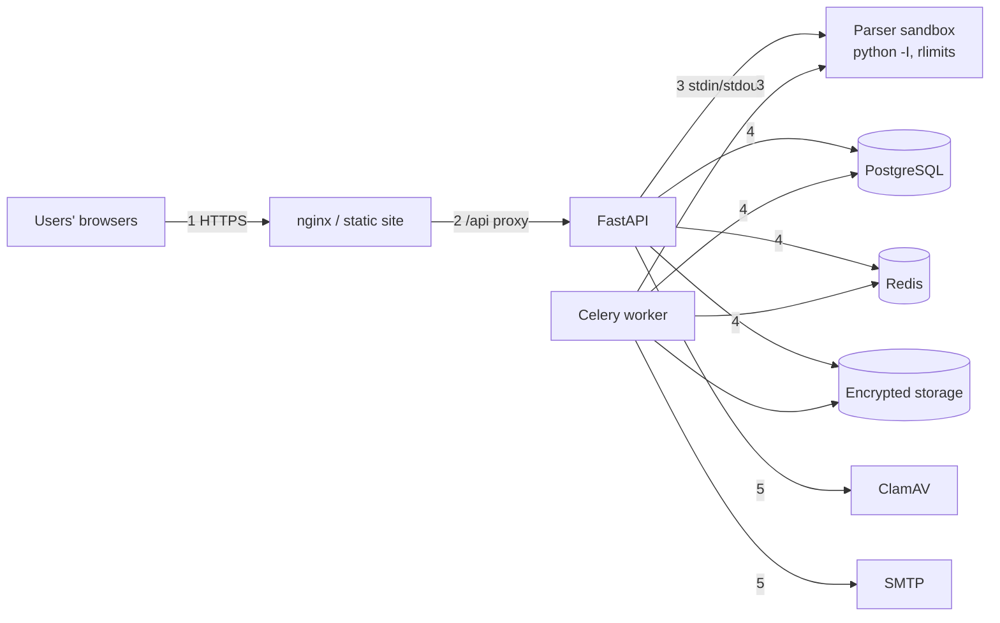

# Threat model

Method: STRIDE per trust boundary. Each threat lists the mitigation in place, where it lives,
and how it is tested. Last reviewed with the code at this commit.

## Assets

| Asset | Why it matters |
|---|---|
| Resume files and extracted text | Personal data: name, contacts, employment history |
| Phone numbers and profiles | Personal data, visible only to the owner and recruiters of jobs applied to |
| Account credentials and sessions | Account takeover; a recruiter or admin account exposes many candidates |
| Application pipeline and interview data | Integrity of hiring decisions |
| Audit log | Evidence of who accessed or changed what |
| Encryption key, JWT secret, database credentials | Compromise exposes everything above |

## Trust boundaries

1. Browser to web edge (nginx / Render static site): untrusted input, cookies.
2. Edge to API: every request is authenticated and authorised in the API, not at the edge.
3. API to the parser sandbox: uploaded files are hostile until proven otherwise.
4. API and worker to PostgreSQL, Redis and object storage: internal network, credentials in
   environment variables.
5. Worker to the mail server (SMTP) and to ClamAV.

## Threats and mitigations

| # | STRIDE | Threat | Mitigation | Where | Tested by |
|---|---|---|---|---|---|
| S1 | Spoofing | Password guessing | bcrypt; 5 failed attempts per email + IP per 15 min; same message for unknown email and wrong password; failed logins audited | `api/auth.py`, `core/rate_limit.py` | `test_auth.py`, e2e `auth-security` |
| S2 | Spoofing | Stolen refresh token | HttpOnly cookie on `/api/auth`, stored hashed, rotated on every use; reuse revokes the family | `services/auth.py` | `test_auth.py`, e2e refresh reuse |
| S3 | Spoofing | Forged or expired JWT | HS256 with a required secret in production; type and expiry checked; user re-read on each request (deactivation is immediate) | `core/security.py`, `core/deps.py` | `test_auth.py`, e2e forged token |
| T1 | Tampering | CSRF against cookie endpoints | SameSite=Lax + required `X-CSRF-Protection` header + Origin check on login/register/refresh/logout; bearer tokens elsewhere | `core/csrf.py` | `test_access_control.py` |
| T2 | Tampering | Changing another recruiter's job, pipeline or interview | Ownership check on every recruiter resource; 403/404 | `services/jobs.py`, `services/applications.py`, `services/interviews.py` | `test_access_control.py` (cross-account) |
| T3 | Tampering | Skipping pipeline stages | Server-side transition table; invalid moves are 422 | `services/applications.py` | `test_applications.py`, e2e `pipeline-rules` |
| T4 | Tampering | Signed download link edited (other resume, longer expiry, other viewer) | HMAC-SHA256 over resume, viewer and expiry; constant-time compare | `core/signing.py` | `test_security.py`, `test_access_control.py` |
| R1 | Repudiation | Denying an access or a change | Audit log with actor, role, target, IP and request id for sign-ins, admin actions, pipeline moves, job and company edits, interviews, resume access by non-owners and deletions | `services/audit.py` | `test_features.py`, e2e audit page |
| I1 | Information disclosure | Seeing another user's resume or phone | Role guards on every route; resume files only via signed links issued after an ownership/application check; phones only to recruiters of the job | `core/deps.py`, `services/resumes.py` | `test_access_control.py` (every route, every role) |
| I2 | Information disclosure | Leaked disk or bucket | Fernet encryption before storage; random storage keys | `services/storage.py` | `test_security.py` |
| I3 | Information disclosure | Stack traces or internals in errors | JSON 500 with a request id only; task errors hidden from non-admins | `core/observability.py`, `api/resumes.py` | `test_health.py` |
| I4 | Information disclosure | XSS or clickjacking exfiltrating data | React escaping; CSP `script-src 'self'`, `frame-ancestors 'none'`, nosniff, no tokens in localStorage | `frontend/nginx.conf`, `render.yaml`, `core/observability.py` | header tests, console sweep (0 CSP violations on 18 pages) |
| I5 | Information disclosure | Bias: a candidate's identity changing their score | Name, contacts, links and institutions removed before embedding | `services/redaction.py` | `test_eval_holdout.py` fairness guard |
| D1 | Denial of service | Malicious file hangs or exhausts the parser | Size limit; zip-bomb checks; parsing in a separate process with timeout and memory/CPU limits | `services/doc_extract.py`, `services/file_scan.py` | `test_security.py` |
| D2 | Denial of service | Request flood exhausting threads and connections | Concurrency limit with 503 + Retry-After; sized pool; health exempt | `ConcurrencyLimitMiddleware` | `test_health.py`, load test (500 users, 0 errors) |
| D3 | Denial of service | Poison background task retried forever | Bounded retries with backoff; permanent errors rejected; dead letter for admins | `tasks/tracking.py` | `test_tasks.py`, `test_reliability.py` |
| E1 | Elevation of privilege | Seeker or recruiter calling admin APIs | `require_role` on every admin route; route table test fails if a new route is unclassified | `core/deps.py` | `test_access_control.py::test_every_route_is_classified` |
| E2 | Elevation of privilege | Code execution through an uploaded file | PDF JavaScript/launch/embedded files and DOCX macros/OLE/remote templates rejected; optional ClamAV (fails closed); parser has no secrets in its environment | `services/file_scan.py`, `services/doc_extract.py` | `test_security.py`, e2e EICAR upload |
| E3 | Elevation of privilege | Vulnerable dependency or base image | pip-audit, npm audit, Trivy on both images in CI, weekly; pip removed from the runtime image | `.github/workflows/security.yml`, Dockerfiles | CI |

## Residual risks (accepted or open)

- **Dev-only tooling advisories.** Vite 5 / Vitest 2 have moderate advisories that affect
  the local dev server and test runner, not the built site; upgrading needs a Vite 8
  migration. CI reports them but fails only on shipped code.
- **Heuristic malware screening.** Without ClamAV (the free deployment), detection is
  limited to the active-content checks.
- **Parser limits on Windows.** Address-space and CPU limits apply on Linux only; on Windows
  only the timeout applies (development machines).
- **Single-region, single-instance free deployment.** No high availability; backups are
  daily, so up to a day of data can be lost in a disaster (see the runbook).
- **Encryption key management.** `FILE_ENCRYPTION_KEY` lives in the host's environment;
  there is no KMS or key rotation tooling. Losing it loses the stored resumes.
- **Signed links are bearer URLs for 5 minutes.** Anyone holding one during that window can
  download the file; every use by a non-owner is audited.
- **Fairness.** Counterfactual name/institution tests only; no outcome measurement for real
  candidate groups (no consented demographic data).
